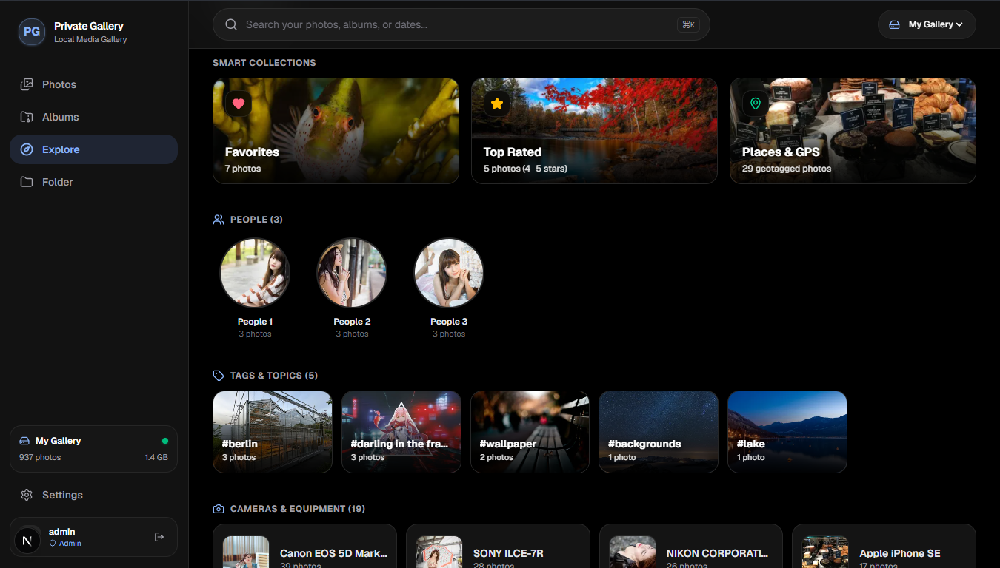

# Private Gallery

**Private Gallery** is a lightning-fast, self-hosted local photo and media gallery server built with **Next.js 16 (App Router)**, **React 19**, **TypeScript**, **Tailwind CSS v4**, **SQLite**, and **Drizzle ORM**.

Designed for media enthusiasts, creators, and privacy advocates, Private Gallery scans your existing local directories on disk, indexes them into SQLite for instant timeline dates, albums, and folder browsing, and streams optimized, disk-cached WebP thumbnails using `sharp`—all without moving or modifying your original media files.



<p align="center">
  <em>Explore View — filter and browse photos by tags, cameras, lenses, and cities.</em><br />
  <strong><a href="./docs/screenshoots">📸 More Screenshots &rarr;</a></strong>
</p>

---

## ✨ Key Features

- **📂 Media-First Directory Indexing**: Photos remain in their original folder structure on disk. SQLite indexes them for lightning-fast search, timeline dates, and album views.
- **⚡ Optimized WebP Caching**: Automatically generates server-side WebP thumbnails (down from ~15MB raw to ~15KB WebP, a 99% reduction) using `sharp`. Supports HTTP `304 Not Modified` caching via ETag.
- **🔍 Advanced Search & Metadata**: Extracts EXIF, GPS, camera, lens, and IPTC/XMP metadata on-demand with automatic EXIF orientation correction. Global search with multi-filter support.
- **📁 Rich Gallery Views**: Seamlessly navigate between Photos view with horizontal justified grid (Immich / Google Photos style), Custom & Folder-backed Albums with infinite scroll, hierarchical Folder browser, and Explore hub.
- **🛡️ Atomic File Operations**: Perform file operations (`delete`, `move`, `copy`, `rename`) directly from the web interface with instant physical disk and SQLite database synchronization.
- **💾 Online Database Backups & Snapshots**: Create instant, WAL-checkpointed SQLite database backups directly from the web interface. Store snapshots on the server, download them to your computer with one click, or restore when needed.
- **🔒 Self-Hosted & Private**: Fully self-contained with authentication (`NextAuth.js`), secure path traversal resolution, and zero external telemetry.
- **🎨 Modular Theming & Accent System**: Clean semantic token architecture supporting multiple dark and light themes (Sleek Dark, OLED Black, Clean Light, Midnight Slate, Warm Amber) paired with vibrant accent colors (Ice Blue, Emerald, Purple, Rose, Amber, Bubblegum Pink).

---

## 🏛️ Tech Stack

- **Framework:** Next.js 16 (App Router) + React 19
- **Language:** TypeScript
- **Styling:** Tailwind CSS v4 + Lucide Icons
- **Database & ORM:** SQLite (`better-sqlite3`) + Drizzle ORM
- **Image Processing:** `sharp` (WebP thumbnails) + `exifr` (EXIF metadata)
- **Authentication:** NextAuth.js (`next-auth`)
- **Package Manager:** `pnpm`

---

## 🚀 Getting Started & Deployment

### Option 1: Docker (Recommended)

Run Private Gallery instantly with Docker Compose:

```yaml
version: "3.8"

services:
  privategl:
    image: ghcr.io/fiand1996/privategl:latest
    container_name: privategl
    ports:
      - "3000:3000"
    environment:
      - AUTH_SECRET=your-secure-random-secret-key
    volumes:
      - ./data:/app/data
      - /path/to/your/photos:/media/photos
    restart: unless-stopped
```

Start the container:

```bash
docker compose up -d
```

### Option 2: Local Development

#### Prerequisites

- **Node.js** (v20+ recommended)
- **pnpm** (`npm install -g pnpm`)

#### Installation & Setup

1. **Clone the repository:**

   ```bash
   git clone https://github.com/fiand1996/privategl.git
   cd privategl
   ```

2. **Install dependencies:**

   ```bash
   pnpm install
   ```

3. **Configure environment variables:**
   Create a `.env` file in the root directory:

   ```env
   AUTH_SECRET="your-secure-random-secret-key"
   ```

4. **Run database migrations:**

   ```bash
   pnpm db:migrate
   ```

5. **Start the development server:**
   ```bash
   pnpm dev
   ```

Open [http://localhost:3000](http://localhost:3000) in your browser.

---

## 📚 Documentation Index

Explore the detailed documentation in the `docs/` directory:

- [System Architecture (`docs/architecture.md`)](./docs/architecture.md)
- [Running & Environment Variables (`docs/running-and-env.md`)](./docs/running-and-env.md)
- [Screenshots (`docs/screenshoots/`)](./docs/screenshoots)

---

## ⚠️ Disclaimer

This project is provided **"as is"**, without warranty of any kind, express or implied. While Private Gallery is engineered with safety safeguards (including non-destructive media indexing, path traversal validation, and atomic database synchronization for file management), you use this software at your own risk.

**Always maintain independent, regular backups of your original media files and database.** The authors and contributors assume no liability or responsibility for any data loss, file corruption, or unintentional modifications resulting from the use of this software.

---

## 🛡️ License

Distributed under the **MIT License**. See `LICENSE` for more information.
